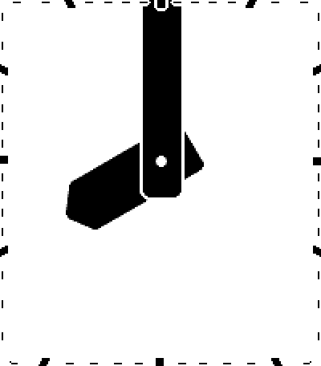
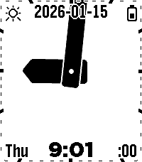
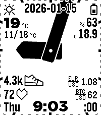
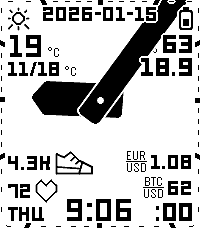
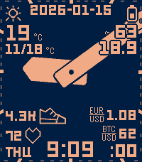

# Aika

A readable analog watchface for the Pebble Time 2.

<p></p>

<table>
  <tr>
    <td align="center"><br>A few widgets</td>
    <td align="center"><br>Many widgets</td>
    <td align="center"><br>Leco fonts</td>
    <td align="center"><br>Night colours</td>
  </tr>
</table>

## Features

- **Extremely bold analog hands**, the minute hand extending past the edges of the screen, for the highest visibility.
- **Widget values are drawn on top of the clock hands.** Values are what counts.
- **Units instead of ambiguous icons:** a widget can show its measurement unit (°C, %, mm/h, c/kWh, …), its icon, or nothing.
- **One weather condition widget:** *WEATHER condition* shows the condition icon with the temperature, the temperature with its unit, the temperature alone, or just the icon. (Older lists with the separate weather icon widget are migrated automatically.)
- **Units and icons are drawn under the hands.** You see them most of the time; the hands come first.
- **A "breathing" clock centre** (on by default): the centre moves up and down with the minute hand's direction. This reduces the distortion from the minute hand's changing length and makes the face feel closer to a square than the rectangular screen really is.
- **Fully customizable widgets:** fonts, sizes, positions, icons and units, in three columns (left edge, right edge, centre).

Widget categories: time, date, weather, rain, health, sleep, battery, crypto, currency, electricity spot price, Tuya sensors & switch states, and Bluetooth.

Other settings: colors, night mode, battery & Bluetooth warnings (border and widget), weather units and data source (Open-Meteo or FMI), rotating widget groups, languages and periodic vibrations.

## Install

- **Pebble appstore:** search for *Aika*.
- **Sideload:** download the `.pbw` from the [releases page](https://github.com/truhanen/pebble-aika-watchface/releases) and open it with the Pebble app on your phone.

## Settings

Open the watchface's settings in the Pebble app.

- **Widgets:** three lists, the left edge, the right edge and the centre column. Each column is laid out top to bottom, spread between the top and bottom of the screen. Add *Empty* widgets to push the others into the corners.
- In each widget row, **Aa** picks the font and **V◉ / VU / V / ◉** picks what stands with the value (V = the value, ◉ = the icon, U = the unit): value and icon, value and unit, value only, or the icon alone.
- **Icon only:** every widget that has an icon (battery, weather condition and forecast, steps, distance, heart rate, sleep, the max-rain windows) can show just that icon: the last step of the identifier switch (`◉`). For example the *WEATHER condition* widget cycles icon and temperature, temperature and unit, temperature alone, and the condition icon alone.
- **Rotating groups** let several widgets take turns in one slot.
- **Plugins:** *Settings > Plugins* lists the values that the phone's Pebble plugins offer (e.g. weather). Add a row and pick Category > Plugin > Item > Instance (only for items with several instances) > Property (numeric properties by name, icon properties as `name (icon)`), up to 16 rows, then place the row from the widget lists. It is named like `WEATHER FMI Loc Jyv Tem` (category, plugin, item, instance, property, each cut to a few letters). Numeric properties follow the identifier switch like other widgets (the value alone `N`, with its unit `N U`, or `N ø` with no identifier; the unit comes from the plugin); icon properties are drawn as the icon alone. Needs a recent Pebble app with plugin support; without it, or when no plugin offers anything, the section says that none is available and no plugin widget shows data. A selection that the phone no longer offers is kept and marked *(unavailable)* in its row, and its widget shows `--` on the watch. Removing a row in the middle leaves its slot empty so the other plugin widgets keep working (an emptied slot shows `--`).
- **Clock:** the *Moving clock centre* and *Minute hand runs off the screen* toggles, leading zero and periodic vibration.
- **Battery:** the face redraws everything at once, so the *Seconds* widget (60 redraws a minute) and fast rotating groups cost battery. Intervals of a minute or longer are free.

## Origins and credits

This watchface is a rework of [Sykerö TimeStyle](https://github.com/Sykero-Software/TimeStylePebble), which is itself a fork of [freakified/TimeStylePebble](https://github.com/freakified/TimeStylePebble) ("TimeStyle").

The widget system, the phone-side data sources (weather, electricity price, crypto, currency, Tuya) and the configuration page come from those projects. The analog clock face comes from the [Nyquist watchface](https://github.com/truhanen/pebble-nyquist-watchface).

## Development

```bash
npm install
pebble build            # also compiles src/ts -> src/pkjs
npm test                # JS unit tests + host-compiled C tests
```

- Build with `TEST_HOOKS=1 pebble build` to enable the emulator test-hook AppMessages (see `src/c/test_hooks.c` and `scripts/emu.sh`).
- Regenerate the README images with `make screenshots` (`scripts/screenshots.sh`: the GIF frames are listed in GIFFRAMES, the stills chosen from them in STILLS).
- Pushing a `v*` tag that matches `package.json`'s version builds the `.pbw` and publishes a GitHub release (`.github/workflows/release.yml`).

### Design notes

- 60 separate edge ticks, one per minute boundary, each 5 px long on the outer edge, which follows the screen frame's rounded corners (tunable `CF_CORNER_R`, 10 px by default). 5-minute ticks are 5 px deep; 1-minute ticks are 1 px deep and set 1 px in from the screen edge. Their sides point at the clock centre, all in the time text colour, each with a 2 px background-colour shadow.
- The moving clock centre holds 14 px above the screen centre while the minute hand points at the top edge and 14 px below while it points at the bottom edge, gliding between them with a smoothstep ease. The ticks are recomputed from the moving centre so each hand still points exactly at its tick.
- The minute hand runs off the screen by default. Optionally it is finite, its head touching the screen edge when it points straight at one.

### Plugins

- Phone side: `plugins.ts` reads the selections (localStorage `plugin_selections`, a JSON array, index `n` is widget id `144+n`, max 16, ids 144..159), makes one one-shot `Pebble.subscribeToSource` per (plugin, category, item) group and sends the result when it changed. `plugins_parse.ts` holds the pure, unit-tested logic (parsing, instance picking, formatting, wire strings); `plugins_catalog.ts` reduces `Pebble.enumeratePlugins()` to numeric (`n`) and icon (`i`) properties (the config page offers both: numeric by name, icon as `name (icon)`, stored with `shape: 'icon'`) and gathers instance names. Polling is enabled by `disable_plugins` = `no`, set when a plugin id is placed in a widget list.
- Catalogue injection: `index.ts` bakes the catalogue (`PluginCatalog`) and the saved selections (`PluginList`) into `clay-settings` before the config URL is generated, because the config page is a separate webview with no access to the phone's plugin API. `config_plugin_catalog.ts` (hidden) carries it and `config_plugin_list.ts` renders the cascading selects. Both are serialised with `toSource()`, so they must be self-contained. The picker names come from `plugin_names.ts` (category upper case, the other parts ASCII-folded and cut to 3 characters, longer on collisions, a numeric suffix as the last resort); the copy inlined in `config_plugin_list.ts` must be kept in sync (a test checks it).
- Wire format: `PluginData` is a string of `slot<US>value<US>unit` records (US = 0x1f). An icon slot's value is `@` and its bitmap follows in its own AppMessage (`PluginIconSlot`, `PluginIconWidth`, `PluginIconHeight`, `PluginIconPalette`, `PluginIconPixels`; 23 px max, 4 bpp, 3-colour palette). Slot values and units are persisted (keys 320/321); icon bitmaps are not (the phone resends them after a restart). See `docs/widget_contract.md`.
- Testing in the emulator without the config page: set `plugin_selections` and `disable_plugins` from the pkjs context, e.g. `localStorage.setItem('plugin_selections', JSON.stringify([{plugin:'00000000-0000-0000-0001-000000000002', category:'weather', item:'location', instanceId:'1', property:'temperature'}]))` and `localStorage.setItem('disable_plugins', 'no')`, then place widget id 144 (see `src/ts/plugins.ts`). The emulator cannot load the Clay page's `http` resources, so the config page cannot be used there.
- `usesPermissions` in `package.json` (Location, Internet with a domain list) must list every host used in `src/ts`; add new hosts there.

## License

This is a combined work distributed under the **GNU General Public License v3.0 only** (GPL-3.0-only); see [`LICENSE`](LICENSE).

- The Nyquist clock face is GPL-3.0.
- The Sykerö TimeStyle additions are GPL-3.0-only, © 2026 Tuomas Airaksinen.
- The upstream TimeStyle code by Dan Tilden and the original TimeStyle contributors is under the **MIT License**. Its copyright and permission notice is kept in [`LICENSE.MIT`](LICENSE.MIT).
