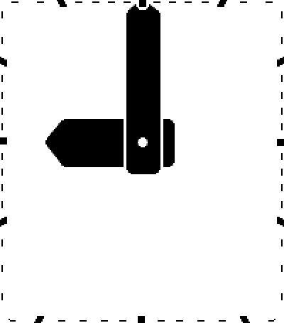
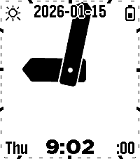
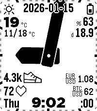
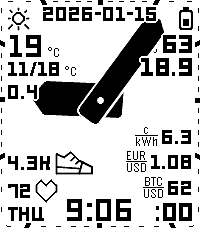

# Nyquist

An analog watchface for the Pebble Time 2 (emery). It uses bold Nyquist-style hands, 60 separate edge ticks (one per minute boundary, each 5 px long on the outer edge, which follows the screen frame's rounded corners (tunable `CF_CORNER_R`, 10 px by default), 5 px deep for 5-minute ticks and 1 px deep, set 1 px in from the screen edge, for 1-minute ticks, with sides pointing at the clock centre, all in the time text colour; each with a 2 px background-colour shadow), and configurable widgets along the left, right, top and bottom edges. The clock centre moves vertically (optional, on by default): up while the minute hand points at the top edge and down at the bottom, so the minute hand (long enough for its tip to touch the screen edge when it points straight at one) reaches the top and bottom edges as well as the sides; optionally the minute hand is longer and always runs off the screen (config: Minute hand runs off the screen); the ticks are recomputed from the moving centre so each hand still points exactly at its tick.

<p></p>

<table>
  <tr>
    <td align="center"><br>A few widgets</td>
    <td align="center"><br>Many widgets</td>
    <td align="center"><br>Leco fonts</td>
    <td align="center"><br>Night colours</td>
  </tr>
</table>

Regenerate the images with `make screenshots` (`scripts/screenshots.sh`: the GIF frames are listed in GIFFRAMES, the stills chosen from them in STILLS).

## Origins and credits

This watchface is a rework of [Sykerö TimeStyle](https://github.com/Sykero-Software/TimeStylePebble), which is itself a fork of [freakified/TimeStylePebble](https://github.com/freakified/TimeStylePebble) ("TimeStyle").

The widget system, the phone-side data sources (weather, electricity price, crypto, currency, Tuya) and the configuration page come from those projects. The analog clock face comes from the [Nyquist watchface](https://github.com/truhanen/pebble-nyquist-watchface).

## Development

```bash
npm install
pebble build            # also compiles src/ts -> src/pkjs
npm test                # JS unit tests + host-compiled C tests
```

Build with `TEST_HOOKS=1 pebble build` to enable the emulator test-hook AppMessages (see `src/c/test_hooks.c` and `scripts/emu.sh`).

## License

This is a combined work distributed under the **GNU General Public License v3.0 only** (GPL-3.0-only); see [`LICENSE`](LICENSE).

- The Nyquist clock face is GPL-3.0.
- The Sykerö TimeStyle additions are GPL-3.0-only, © 2026 Tuomas Airaksinen.
- The upstream TimeStyle code by Dan Tilden and the original TimeStyle contributors is under the **MIT License**. Its copyright and permission notice is kept in [`LICENSE.MIT`](LICENSE.MIT).
