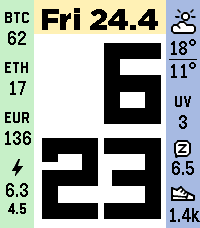

# Nyquist 3

An analog watchface for the Pebble Time 2 (emery). It uses bold Nyquist-style hands, 60 separate edge ticks (one per minute boundary, each 6 px long and 4 px deep, black on the 5-minute marks and light gray otherwise), and configurable widgets along the left, right, top and bottom edges.

<p></p>

## Origins and credits

Nyquist 3 is a rework of [Sykerö TimeStyle](https://github.com/Sykero-Software/SykeroTimeStylePebble), which is itself a fork of [freakified/TimeStylePebble](https://github.com/freakified/TimeStylePebble) ("TimeStyle").

The widget system, the phone-side data sources (weather, electricity price, crypto, currency, Tuya) and the configuration page come from those projects. The analog clock face comes from the [Nyquist watchface](https://github.com/truhanen/pebble-nyquist-watchface).

## Development

```bash
npm install
pebble build            # also compiles src/ts -> src/pkjs
npm test                # JS unit tests + host-compiled C tests
```

Build with `TEST_HOOKS=1 pebble build` to enable the emulator test-hook AppMessages (see `src/c/test_hooks.c` and `scripts/emu.sh`).

## License

This is a combined work distributed under the **GNU General Public License v3.0 only** (GPL-3.0-only); see [`LICENSE`](LICENSE).

- The Nyquist clock face is GPL-3.0.
- The Sykerö TimeStyle additions are GPL-3.0-only, © 2026 Tuomas Airaksinen.
- The upstream TimeStyle code by Dan Tilden and the original TimeStyle contributors is under the **MIT License**. Its copyright and permission notice is kept in [`LICENSE.MIT`](LICENSE.MIT).
