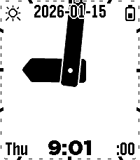
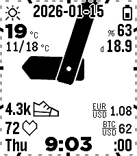
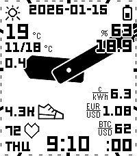
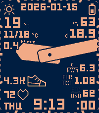

# Aika

A readable analog watchface for the Pebble Time 2.

<p></p>

<table>
  <tr>
    <td align="center"><br>A few widgets</td>
    <td align="center"><br>Many widgets</td>
    <td align="center"><br>Leco fonts</td>
    <td align="center"><br>Night colours</td>
  </tr>
</table>

## Features

- **Extremely bold analog hands**, the minute hand extending past the edges of the screen, for the highest visibility.
- **Widget values are drawn on top of the clock hands.** Values are what counts.
- **Units instead of ambiguous icons:** a widget can show its measurement unit (°C, %, mm/h, c/kWh, …), its icon, or nothing.
- **Units and icons are drawn under the hands.** You see them most of the time; the hands come first.
- **A "breathing" clock centre** (on by default): the centre moves up and down with the minute hand's direction. This reduces the distortion from the minute hand's changing length and makes the face feel closer to a square than the rectangular screen really is.
- **Fully customizable widgets:** fonts, sizes, positions, icons and units, in three columns (left edge, right edge, centre).

Widget categories: time, date, weather, rain, health, sleep, battery, crypto, currency, electricity spot price, Tuya sensors & switch states, and Bluetooth.

Other settings: colors, night mode, battery & Bluetooth warnings (border and widget), weather units and data source (Open-Meteo or FMI), rotating widget groups, languages and periodic vibrations.

## Install

- **Pebble appstore:** search for *Aika*.
- **Sideload:** download the `.pbw` from the [releases page](https://github.com/truhanen/pebble-aika-watchface/releases) and open it with the Pebble app on your phone.

## Settings

Open the watchface's settings in the Pebble app.

- **Widgets:** three lists, the left edge, the right edge and the centre column. Each column is laid out top to bottom, spread between the top and bottom of the screen. Add *Empty* widgets to push the others into the corners.
- In each widget row, **Aa** picks the font and **◉ / U / ⊘** picks the identifier: the icon, the unit, or none.
- **Rotating groups** let several widgets take turns in one slot.
- **Clock:** the *Moving clock centre* and *Minute hand runs off the screen* toggles, leading zero and periodic vibration.
- **Battery:** the face redraws everything at once, so the *Seconds* widget (60 redraws a minute) and fast rotating groups cost battery. Intervals of a minute or longer are free.

## Origins and credits

This watchface is a rework of [Sykerö TimeStyle](https://github.com/Sykero-Software/TimeStylePebble), which is itself a fork of [freakified/TimeStylePebble](https://github.com/freakified/TimeStylePebble) ("TimeStyle").

The widget system, the phone-side data sources (weather, electricity price, crypto, currency, Tuya) and the configuration page come from those projects. The analog clock face comes from the [Nyquist watchface](https://github.com/truhanen/pebble-nyquist-watchface).

## Development

```bash
npm install
pebble build            # also compiles src/ts -> src/pkjs
npm test                # JS unit tests + host-compiled C tests
```

- Build with `TEST_HOOKS=1 pebble build` to enable the emulator test-hook AppMessages (see `src/c/test_hooks.c` and `scripts/emu.sh`).
- Regenerate the README images with `make screenshots` (`scripts/screenshots.sh`: the GIF frames are listed in GIFFRAMES, the stills chosen from them in STILLS).
- Pushing a `v*` tag that matches `package.json`'s version builds the `.pbw` and publishes a GitHub release (`.github/workflows/release.yml`).

### Design notes

- 60 separate edge ticks, one per minute boundary, each 5 px long on the outer edge, which follows the screen frame's rounded corners (tunable `CF_CORNER_R`, 10 px by default). 5-minute ticks are 5 px deep; 1-minute ticks are 1 px deep and set 1 px in from the screen edge. Their sides point at the clock centre, all in the time text colour, each with a 2 px background-colour shadow.
- The moving clock centre holds 14 px above the screen centre while the minute hand points at the top edge and 14 px below while it points at the bottom edge, gliding between them with a smoothstep ease. The ticks are recomputed from the moving centre so each hand still points exactly at its tick.
- The minute hand runs off the screen by default. Optionally it is finite, its head touching the screen edge when it points straight at one.

## License

This is a combined work distributed under the **GNU General Public License v3.0 only** (GPL-3.0-only); see [`LICENSE`](LICENSE).

- The Nyquist clock face is GPL-3.0.
- The Sykerö TimeStyle additions are GPL-3.0-only, © 2026 Tuomas Airaksinen.
- The upstream TimeStyle code by Dan Tilden and the original TimeStyle contributors is under the **MIT License**. Its copyright and permission notice is kept in [`LICENSE.MIT`](LICENSE.MIT).
